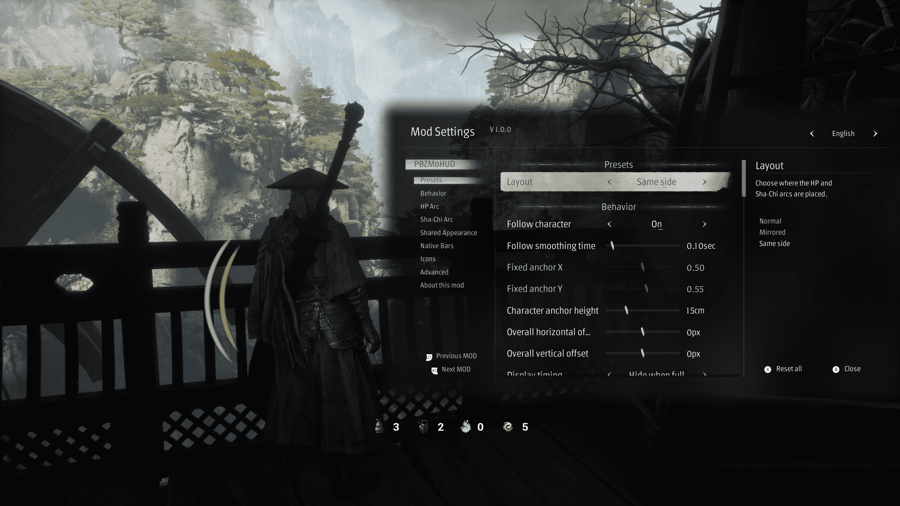

# PBZMoHUD

Ink-wash arc health and Qi bars for Phantom Blade Zero, with per-arc layout, colours, ghost trails and brush tips, plus medicine and Qi icons drawn over the game HUD.

## What it does

- Replaces the flat health and Qi readouts with two independent arcs; radius, span, rotation, thickness, fill direction, offsets, colours, ghost trail and brush tip are set per arc.
- Adds medicine, pure-Qi and dark-source icons with adjustable anchors; icon groups can be dragged on screen.
- Optionally pins the game's native bars to a fixed length and shows current / maximum values on them.
- Shows a break-state colour on the Qi arc while the character is staggered.
- Settings live in `Scripts/settings.ini`. With PBZMoConfig they are edited in the shared in-game panel with live preview; without it the ini can be edited by hand and the HUD still runs.

## Screenshots

## How to install

1. Install UE4SS 3.x for Phantom Blade Zero. For the in-game settings panel, live preview and icon dragging, also install PBZMoConfig with event and deferred-save support.
2. Get the mod files: download the archive from the latest GitHub release, or copy the `PBZMoHUD` folder from this repository.
3. Close the game, then put the folder at `<game>/platform/steam/ue4ss/Mods/PBZMoHUD`, keeping `Scripts/`, `lang/` and `enabled.txt`.
4. Start the game. If `Scripts/settings.ini` is missing the HUD uses defaults; it never creates or rewrites that file on startup.

To update, replace the code and `lang/` files and keep `Scripts/settings.ini` and `enabled.txt`. To remove, delete the folder. No save data is changed. `install_to_game.py` is a local helper for this copy (dry-run by default, `--apply --sync` to write); it preserves an existing ini and never touches other mods.

## How to use

With PBZMoConfig: press `HOME`, select **PBZMoHUD** in the left list, edit values to preview them, then press `T` to write the current mod's draft. `R` restores defaults; `Esc` closes and asks about unsaved changes. Discarding a draft rolls the HUD back.

To move icons, run **Drag icons** on the settings page. The panel folds away; left-drag a group, right-drag a single icon, middle-click to reset a group to its automatic anchor. `Esc` returns to the panel, and the new positions are written only when the changes are applied.

Without PBZMoConfig, edit `Scripts/settings.ini` directly (`Key = value`, booleans `true` / `false`, colours `#RRGGBB`, comments on their own `;` lines). The full key list is in `README.md`.

## Compatibility

- Requires UE4SS 3.x. PBZMoConfig is optional for the HUD itself and required for the settings panel, live preview, save requests and icon dragging.
- Do not enable `PBZPlayerArcs` at the same time: both draw the same HUD. Settings from that older mod are not migrated.
- Read-only towards the game: no character stats, combat state or save data are modified. The native bar pin only writes to the game's own bar widgets.
- The settings text follows the language selected in PBZMoConfig; missing translations fall back to English.

## Known issues

Break detection reads gameplay tags and animation names. A game update that renames them can stop the break hint until the mod is updated. Offline tests cannot replace in-game checks of rotation, dragging and native bar length after level changes or equipment upgrades.

## How to build

Nothing to build: the release contains the files of this repository.

The mod is plain Lua loaded by UE4SS; there is no compiler, bundler or generated artifact. `install_to_game.py` copies runtime files into a game installation (dry-run by default); it is not a build step.

## Credits

Refactored from PBZPlayerArcs v0.4.0, kept in a separate repository. By Moirstral. AGPL-3.0, see `LICENSE`.
